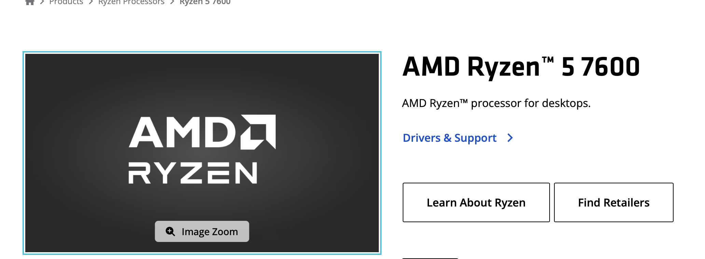
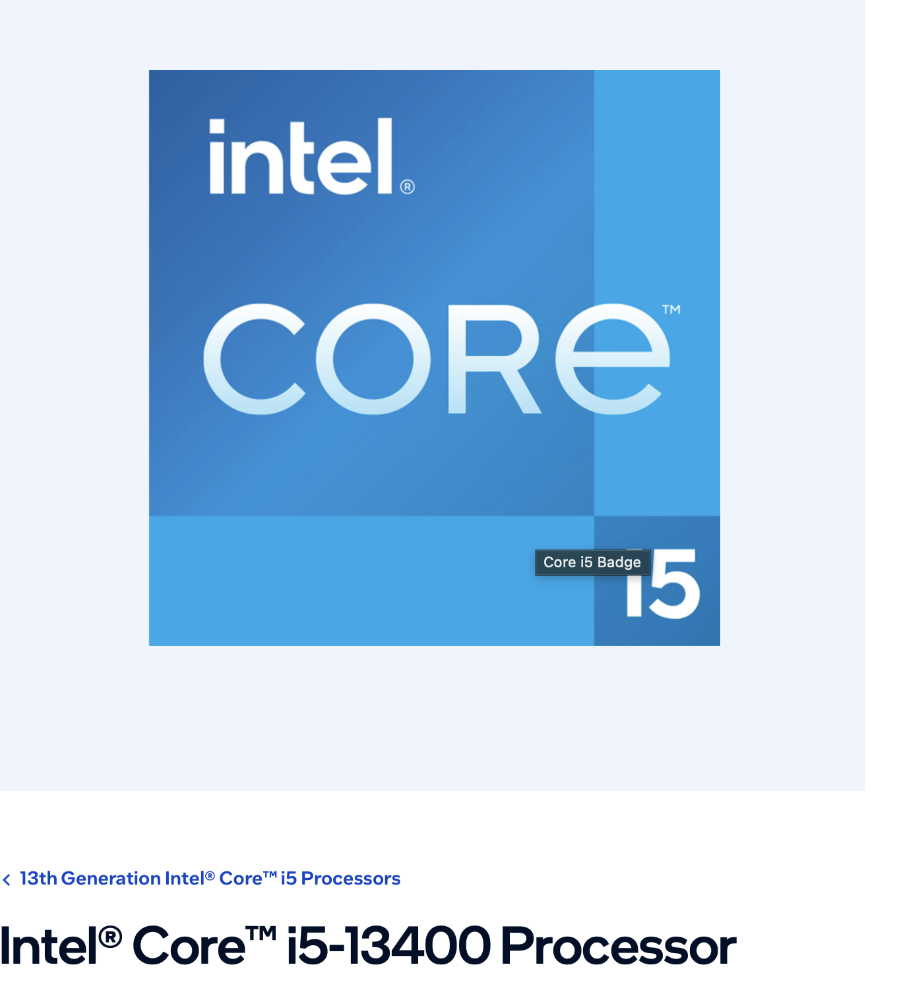
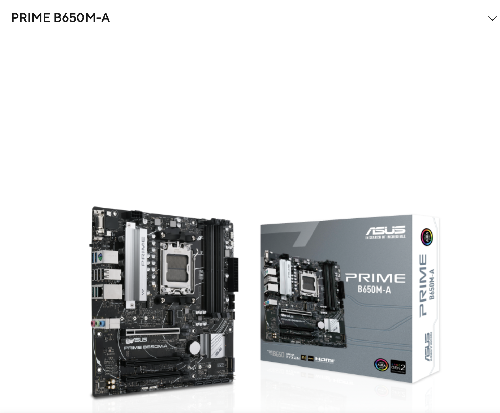
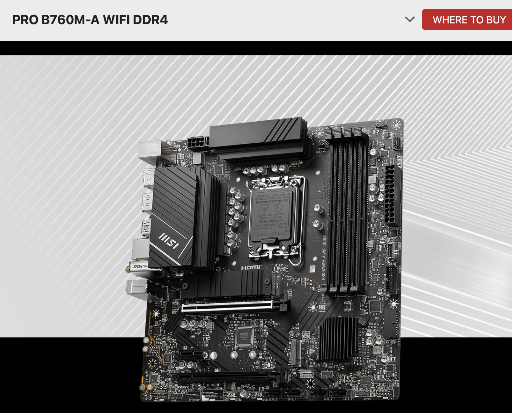
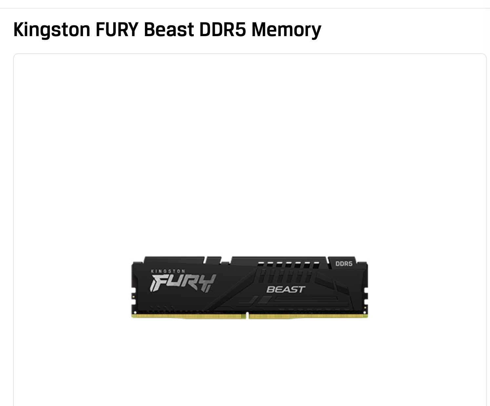
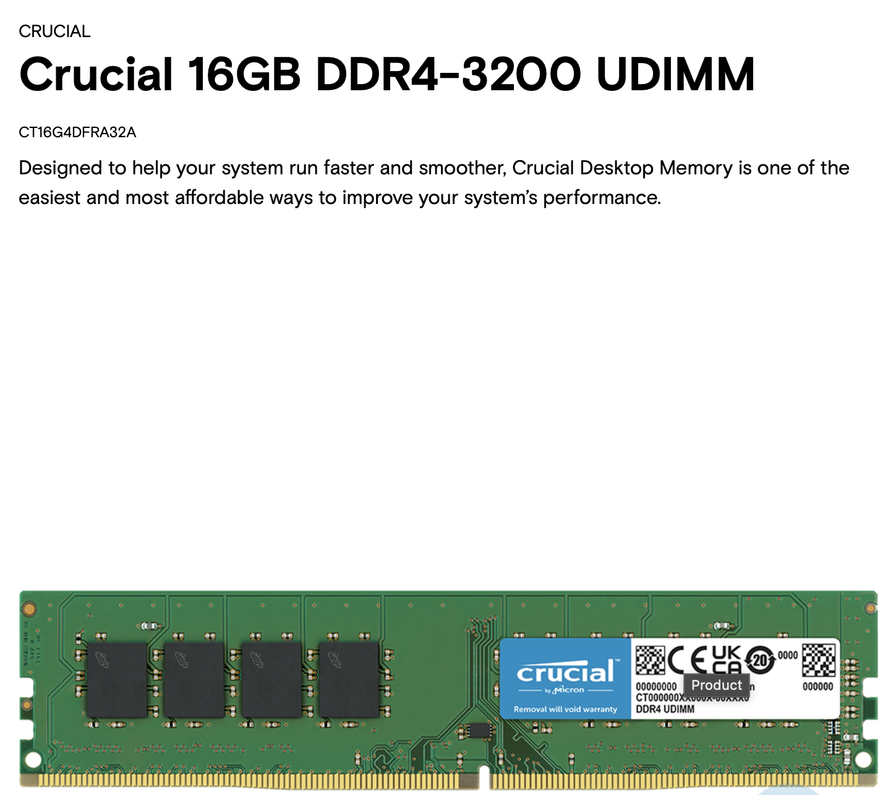
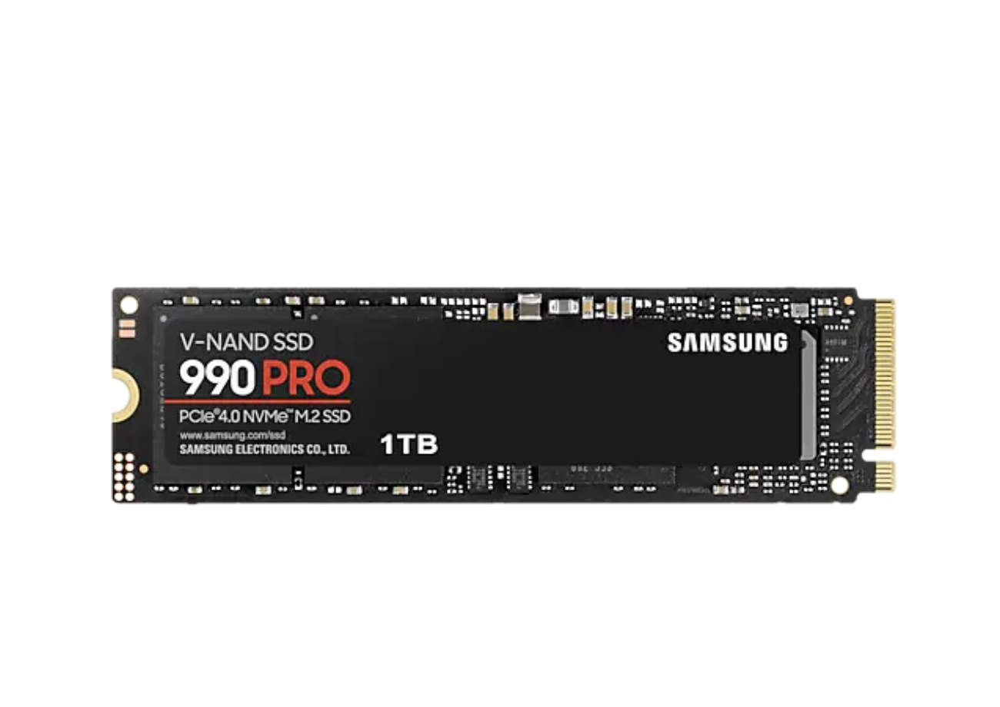
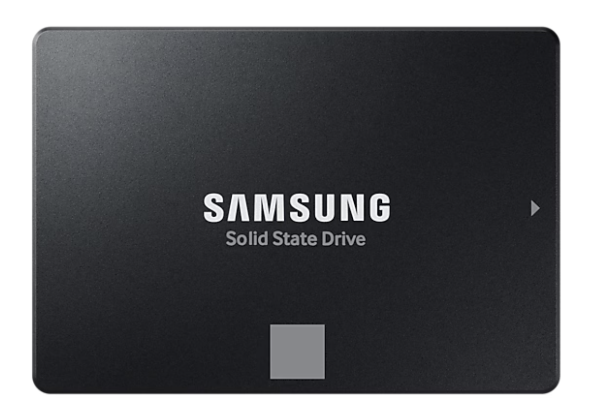
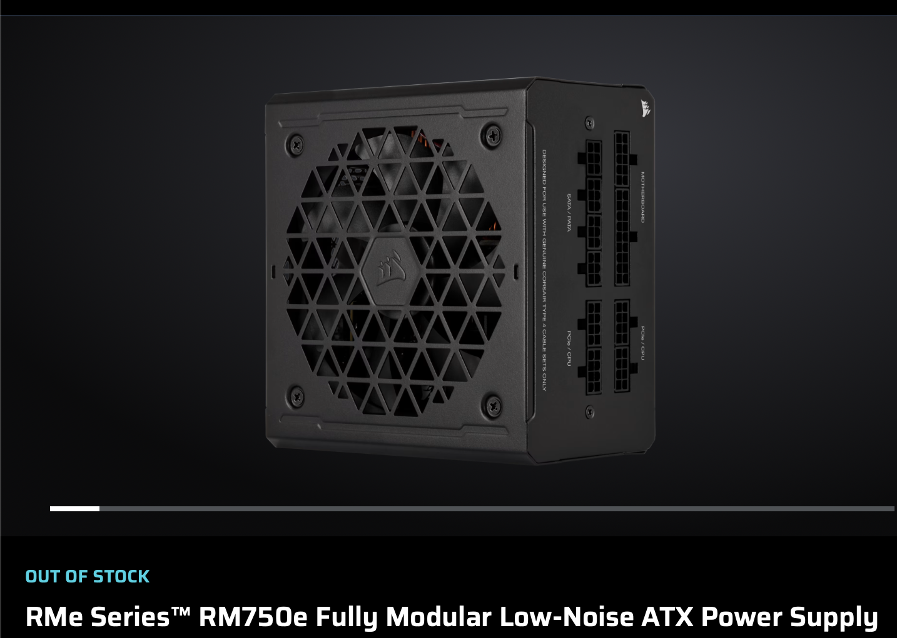
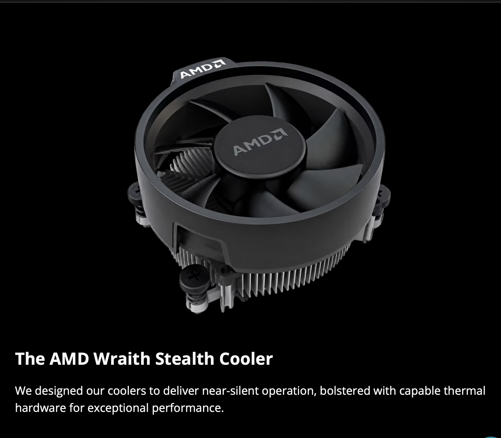

# Lab 3 — Teardown, and the same machine from the command line

Pair:Eva Zadorozhnaya + Vitalina Shemetova                   
Date: 12.11.2026

## Part 1 – Ten parts

### AMD Ryzen 5 7600

- What it is: Desktop processor with 6 cores / 12 threads, 3.8 GHz base clock (up to 5.1 GHz max boost), 32 MB L3 cache (38 MB total cache), and 65 W default TDP.
- Connects to: Socket AM5 and a dual-channel DDR5 memory controller (up to 5200 MT/s).
- Limit: Fits only AM5 motherboards and supports only DDR5 RAM (incompatible with AM4 boards and DDR4 memory).
- Source: <https://www.amd.com/en/products/processors/desktops/ryzen/7000-series/amd-ryzen-5-7600.html>

### Intel Core i5-13400

- What it is: Desktop processor with 10 cores (6 Performance-cores + 4 Efficient-cores) / 16 threads, 2.50 GHz P-core base clock (up to 4.60 GHz max turbo), 20 MB Intel Smart Cache (L3), and 65 W processor base power (148 W maximum turbo power).
- Connects to: Socket LGA 1700 (FCLGA1700) and a dual-channel hybrid memory controller supporting DDR5 (up to 4800 MT/s) or DDR4 (up to 3200 MT/s).
- Limit: Fits only LGA 1700 motherboards; only one memory standard (either DDR4 or DDR5) can be used at a time, fixed by the chosen motherboard's DIMM slots.
- Source: <https://www.intel.com/content/www/us/en/products/sku/230495/intel-core-i513400-processor-20m-cache-up-to-4-60-ghz/specifications.html>

### ASUS PRIME B650M-A

- What it is: Micro-ATX desktop motherboard built on the AMD B650 chipset.
- Connects to: AMD Socket AM5, 4x DDR5 DIMM slots (dual-channel, up to 128/192 GB), 2x M.2 slots (1x PCIe 5.0 x4 and 1x PCIe 4.0 x4), 4x SATA 6Gb/s ports, and standard 24-pin ATX + 8-pin CPU power connectors.
- Limit: Accepts only AMD Ryzen 7000/8000/9000 Series desktop processors (Ryzen 8000/9000 require a BIOS update) and supports only DDR5 RAM (incompatible with Intel CPUs and DDR4 modules).
- Source: <https://www.asus.com/motherboards-components/motherboards/prime/prime-b650m-a/>

### MSI PRO B760M-A WIFI DDR4

- What it is: Micro-ATX desktop motherboard built on the Intel B760 chipset.
- Connects to: Intel Socket LGA 1700, 4x DDR4 DIMM slots (dual-channel, up to 128 GB), 2x M.2 slots (PCIe 4.0 x4), 4x SATA 6Gb/s ports, and standard 24-pin ATX + 8-pin (plus 4-pin) CPU power connectors.
- Limit: Accepts only 12th, 13th, and 14th Gen Intel Core processors (14th Gen requires a BIOS update) and supports only DDR4 RAM (incompatible with AMD CPUs and DDR5 modules).
- Source: <https://www.msi.com/Motherboard/PRO-B760M-A-WIFI-DDR4>

### Kingston FURY Beast DDR5-5600, 16 GB

- What it is: DDR5 UDIMM desktop memory module, 16 GB capacity, 5600 MT/s speed, 288 pins.
- Connects to: A DDR5 DIMM slot on a desktop motherboard (such as the ASUS PRIME B650M-A).
- Limit: Fits only DDR5-compatible motherboards; the physical key notch prevents insertion into DDR4 slots, and it cannot fit laptop SO-DIMM slots.
- Source: < https://www.kingston.com/en/memory/gaming/kingston-fury-beast-ddr5-memory>

### Crucial DDR4-3200, 16 GB DIMM

- What it is: DDR4 UDIMM desktop memory module, 16 GB capacity, 3200 MT/s speed (PC4-25600), 288 pins, CL22 latency, 1.2 V.
- Connects to: A DDR4 DIMM slot on a desktop motherboard (such as the MSI PRO B760M-A WIFI DDR4).
- Limit:Fits only DDR4-compatible desktop motherboards; the physical key notch prevents insertion into DDR5 slots, and its full length makes it incompatible with laptop SO-DIMM slots.
- Source: < https://www.crucial.com/memory/ddr4/ct16g4dfra32a>

### Samsung 990 PRO 1 TB

- What it is:  Internal NVMe SSD, 1 TB capacity, PCIe 4.0 x4 (NVMe 2.0) interface, M.2 2280 form factor, up to 7,450 MB/s sequential read and 6,900 MB/s write speed.
- Connects to: An M.2 slot (M-key) directly on the motherboard without any data or power cables.
- Limit: Requires an M.2 slot wired with PCIe lanes (cannot connect to standard SATA ports); its speed is capped by the motherboard's PCIe 4.0 x4 bus bandwidth (~7,500 MB/s), or even lower if installed in a PCIe 3.0 slot.
- Source: <https://www.samsung.com/uk/memory-storage/nvme-ssd/990-pro-1tb-nvme-pcie-gen-4-mz-v9p1t0bw/>

### Samsung 870 EVO 1 TB

- What it is:  Internal SATA SSD, 1 TB capacity, SATA 6 Gb/s (SATA III) interface, 2.5-inch form factor, up to 560 MB/s sequential read and 530 MB/s write speed.
- Connects to:  A motherboard SATA port via a SATA data cable and to the power supply (PSU) via a SATA power cable.
- Limit: Bottlenecked by the SATA III bus ceiling (~550–560 MB/s), making it over 13 times slower than PCIe 4.0 NVMe drives; physically incompatible with M.2 slots.
- Source: < https://www.samsung.com/kz_ru/memory-storage/sata-ssd/870-evo-1tb-sata-3-2-5-ssd-mz-77e1t0bw/?srsltid=AYCX9vKXfD2slmEeISeKeHuohaIuEWILz_0wr7IYrLdnzDEXq_Yi9O2J>

### Corsair RM750e

- What it is:  Fully modular ATX 3.0 power supply unit (PSU) rated at 750 W with 80 PLUS Gold efficiency.
- Connects to: Motherboard (24-pin ATX and 8-pin EPS/CPU connectors), storage drives (SATA power), and graphics card (PCIe / 12VHPWR).
- Limit: Total continuous power output is capped at 750 W across all connected components; uses standard ATX dimensions, so it will not fit compact SFX-only cases, and requires Corsair Type-4 modular cables.
- Source: < https://www.corsair.com/us/en/p/psu/cp-9020262-na/rme-series-rm750e-fully-modular-low-noise-atx-power-supply-cp-9020262-na>

### AMD Wraith Stealth

- What it is: Low-profile air CPU cooler (AMD Wraith Stealth) with an aluminum heatsink, bundled in the box with the AMD Ryzen 5 7600 processor, rated for 65 W TDP.
- Connects to: Socket AM5 mounting backplate/holes on the motherboard (via 4 spring-loaded screws) and the 4-pin CPU_FAN PWM header.
- Limit: Designed strictly for 65 W TDP processors (cannot adequately cool higher-wattage or overclocked CPUs) and fits only AMD AM4/AM5 mounting holes (incompatible with Intel LGA 1700 sockets).
- Source: <https://www.amd.com/en/products/processors/ecosystem/cpu-cooler-solutions.html>

Step 3 — The Motherboards

1. ASUS PRIME B650M-A
	• Socket: AMD Socket AM5.
	• Chipset: AMD B650.
	• Memory: DDR5, 4x DIMM slots (Dual-Channel, up to 128/192 GB).
	• Storage: 2x M.2 slots (1x PCIe 5.0 x4, 1x PCIe 4.0 x4) and 4x SATA 6Gb/s ports.
	• CPU Support: AMD Ryzen 7000 Series desktop processors out of the box; Ryzen 8000 and 9000 Series supported with a BIOS update.
2. MSI PRO B760M-A WIFI DDR4
	• Socket: Intel Socket LGA 1700.
	• Chipset: Intel B760.
	• Memory: DDR4, 4x DIMM slots (Dual-Channel, up to 128 GB).
	• Storage: 2x M.2 slots (PCIe 4.0 x4) and 4x SATA 6Gb/s ports.
	• CPU Support: 12th and 13th Gen Intel Core processors out of the box; 14th Gen Intel Core supported with a BIOS update.

## Two builds

### Build 1 (AMD AM5 / DDR5)

| Part | Model | Why it fits here |
| :--- | :--- | :--- |
| CPU | AMD Ryzen 5 7600 | Matches the motherboard's AM5 socket and supports DDR5 memory. |
| Motherboard | ASUS PRIME B650M-A | Provides the AM5 socket for the Ryzen 5 7600 and DDR5 DIMM slots. |
| Memory | Kingston FURY Beast DDR5-5600, 16 GB | Matches the board's DDR5 DIMM slots and the CPU's DDR5 memory controller. |
| SSD | Samsung 990 PRO 1 TB | Connects directly into one of the board's two M.2 PCIe 4.0/5.0 slots without cables. |
| PSU | Corsair RM750e (750 W) | Provides standard 24-pin ATX and 8-pin CPU power connectors with plenty of wattage headroom. |
| Cooler | AMD Wraith Stealth (Stock Cooler) | Bundled with the Ryzen 5 7600, fits AM5 mounting holes, and handles its 65 W TDP. |

### Build 2 (Intel LGA 1700 / DDR4)

| Part | Model | Why it fits here |
| :--- | :--- | :--- |
| CPU | Intel Core i5-13400 | Matches the motherboard's LGA 1700 socket and supports DDR4 memory. |
| Motherboard | MSI PRO B760M-A WIFI DDR4 | Provides the LGA 1700 socket for the i5-13400 and DDR4 DIMM slots. |
| Memory | Crucial DDR4-3200, 16 GB DIMM | Matches the board's DDR4 UDIMM slots and the i5-13400's DDR4 memory controller. |
| SSD | Samsung 870 EVO 1 TB | Connects to one of the board's four SATA 6Gb/s ports via a SATA data cable. |
| PSU | *Missing (needs an ATX PSU)* | Only one power supply was provided in the 10-part list (already assigned to Build 1). |
| Cooler | *Missing (needs an LGA 1700 cooler)* | Only one stock cooler was listed in the 10 parts (and the AM5 cooler does not fit LGA 1700). |

What each build still needs: **Build 1** still needs a monitor with a display cable (the Ryzen 5 7600 has integrated Radeon Graphics, so a discrete GPU is not required), a keyboard/mouse, an OS installer USB drive, and a power cord plus a case power button (or jumping the front-panel power pins). **Build 2** is missing an **ATX power supply (PSU)**, an **LGA 1700 CPU cooler**, a **SATA data cable** for the 2.5" SSD, as well as a monitor, peripherals, an OS installer, and a power cord/button (the non-F i5-13400 has integrated Intel UHD 730 graphics).

## Part 2 — Same facts, three operating systems

## Comparison

| Fact | Windows (PowerShell) | Linux (Ubuntu VM) | macOS |
| :--- | :--- | :--- | :--- |
| **CPU model** | `Get-CimInstance Win32_Processor \| Select Name` (`AMD Ryzen 7 7435HS`) | `lscpu` (Vendor `Apple`, Model name `-` — hypervisor hides the exact chip name) | `sysctl -n machdep.cpu.brand_string` (`Apple M5`) |
| **Cores / threads** | `Get-CimInstance Win32_Processor \| Select NumberOfCores, NumberOfLogicalProcessors` (`8` cores / `16` threads) | `lscpu` (`2` virtual CPUs / `2` cores, `1` thread per core) | `sysctl hw.physicalcpu hw.logicalcpu` (`10` physical / `10` logical) |
| **Total memory** | `Get-CimInstance Win32_PhysicalMemory \| Select Capacity` (`24 GB` / two `12884901888`-byte modules) | `free -h` (`3.3Gi` usable out of `4 GB` allocated to the VM) | `sysctl hw.memsize` (`17179869184` bytes / `16 GB`) |
| **Memory modules and speed** | `Get-CimInstance Win32_PhysicalMemory \| Select DeviceLocator, Speed, SMBIOSMemoryType` (`2x DIMM 0`, `4800 MT/s`, DDR5 / type `34`) | `sudo dmidecode -t memory` (`1x 4 GB` virtual DIMM, Manufacturer `VMware Virtual RAM`, `Speed: Unknown`, `4800 MT/s` configured) | `system_profiler SPMemoryDataType` (`16 GB`, `LPDDR5`, Manufacturer `Micron`, speed hidden) |
| **Disk model and type** | `Get-PhysicalDisk \| Select FriendlyName, MediaType, BusType` (`Micron MTFDKCD512QFM-1BD1AABLA`, `SSD`, `NVMe`) | `lsblk -d -o NAME,MODEL,ROTA,TRAN,SIZE` (`nvme0n1`, `VMware Virtual NVMe Disk`, `nvme`, `25G`) | `diskutil info disk0` (`APPLE SSD AP0512Z`, Solid State `Yes`, Protocol `Apple Fabric`) |
| **Free space** | `Get-Volume C` (`45.71 GB` free of `475.86 GB`) | `df -h /` (`6.4G` available of `11G` root partition) | `diskutil info disk0` (`500.3 GB` total disk size; free space shown on the APFS data volume) |
| **Architecture (x86-64 / ARM64)** | `$env:PROCESSOR_ARCHITECTURE` (`AMD64`) | `uname -m` (`aarch64`) | `uname -m` (`arm64`) |

The three operating systems use different naming conventions and units for the same hardware concepts: Windows reports 64-bit x86 as `AMD64` and returns capacities in raw bytes (`Capacity`, `Size`), macOS identifies Apple Silicon as `arm64` and hides RAM clock speed due to unified on-package `LPDDR5` memory, while Linux reports the same ARM architecture as `aarch64`. Additionally, the Linux virtual machine only sees virtualized hardware exposed by VMware rather than the real Mac host: it hides the `Apple M5` model name behind `-`, restricts CPU cores from `10` to `2` and total RAM from `16 GB` to `4 GB` (`3.3 GiB` usable), and abstracts the physical `APPLE SSD AP0512Z` into a `25G` `VMware Virtual NVMe Disk`.

## What did not work the first time

* **Finding exact official part images:** Searching for `AMD Ryzen 5 7600` initially returned the `Ryzen 5 7600X` product page, and the official `Ryzen 5 7600` page showed a generic Ryzen logo banner instead of a physical chip/box photo. Similarly, the AMD cooling page first displayed the RGB `Wraith Prism` cooler instead of the bundled `Wraith Stealth`. I verified the exact non-X model URL and scrolled down to the `Wraith Stealth` section to capture the right screenshots.
* **Transferring the Linux log file from the headless Ubuntu VM:** Because my Ubuntu Server VM runs in a terminal-only window without a GUI or shared clipboard, copy-pasting commands and dragging files to macOS did not work initially. I typed the commands directly in the VM terminal, checked its local IP address with `hostname -I`, and transferred `linux-specs.txt` to my Mac via `scp`.

## Evidence

## Evidence

[evidence/windows-specs.txt](evidence/windows-specs.txt) — PowerShell hardware output collected from my partner's Windows laptop (`AMD Ryzen 7 7435HS`, 24 GB DDR5, Micron NVMe SSD), as my primary machine is a MacBook.
[evidence/linux-specs.txt](evidence/linux-specs.txt) — Terminal output from my Ubuntu ARM64 virtual machine running on VMware (`2` vCPUs, `4 GB` virtual RAM, `25 GB` virtual NVMe disk).
[evidence/macos-specs.txt](evidence/macos-specs.txt) — Terminal output collected directly from my host MacBook (`Apple M5`, `16 GB` LPDDR5, `APPLE SSD AP0512Z`).
