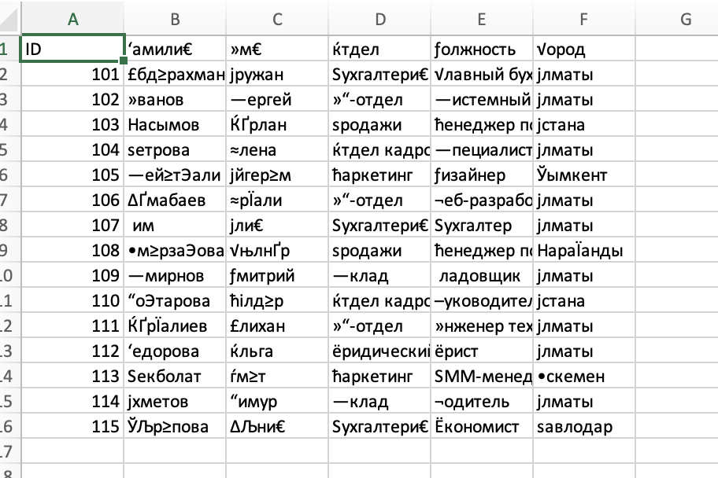

# Lab 5 — Encoding forensics

Name: Eva Zadorozhnaya · Date: 19.11.2026 · Tools: macOS Terminal (Apple Silicon), Excel

## What I received
- Excel (double-click): columns split correctly, but every capital Cyrillic letter and every Kazakh letter is wrong (Фамилия → ‘амили€, Әбдірахманова → £бд≥рахманова). Excel for Mac read the bytes as Mac Cyrillic, where lowercase letters have the same bytes as in KZ-1048, but capitals and Kazakh letters do not.
- LibreOffice: not checked — I could not install LibreOffice on my laptop (see "What did not work the first time").
- Terminal (`cat`): Latin letters and digits readable, all Cyrillic letters shown as garbage symbols.



## Diagnosis (made before the fix)
The original file: [evidence/staff-broken.csv](evidence/staff-broken.csv) (never edited). Full diagnosis: [evidence/diagnosis.txt](evidence/diagnosis.txt).

- `file` said: `Non-ISO extended-ASCII text, with CRLF line terminators` ([evidence/file-before.txt](evidence/file-before.txt)) — one byte per letter, a legacy code page; `file` cannot tell which one, so the bytes decide.
- First 16 bytes: `49 44 3b d4 e0 ec e8 eb e8 ff 3b c8 ec ff 3b ce` = `ID;Фамилия;Имя;О` ([evidence/hexdump-before.txt](evidence/hexdump-before.txt))
- Encoding: **KZ-1048** (iconv name `RK1048`) — because every Cyrillic letter is one byte, not a `D0`/`D1` pair (so not UTF-8): "Фамилия" = `d4 e0 ec e8 eb e8 ff`. The surname on line 2 starts with byte `A3`: in KZ-1048 `A3` = "Ә" → "Әбдірахманова"; in Windows-1251 `A3` = "Ј" → "Јбдірахманова", which is wrong. Decoded as KZ-1048, every name, Russian and Kazakh, reads correctly.
- Line ending: **CRLF** — because line 1 ends with `0d 0a` (offset `0x24`–`0x25`).
- BOM: **no** — because the file starts with `49 44` ("ID"), not `EF BB BF`. In the fixed file I **added** it, because the brief requires the file to open correctly in Excel by double-click: without a BOM Excel guesses a legacy encoding and shows garbage.
- Separator: `;` (byte `3b`).
- Line ending in the fixed file: **LF**, because it is the standard on macOS and Linux and does not break scripts (`$'\r': command not found`); Excel reads LF without problems.

## Fix
[scripts/fix.sh](scripts/fix.sh), run from this folder with `sh scripts/fix.sh`. It writes [evidence/staff-fixed.csv](evidence/staff-fixed.csv); the original is never modified.

```sh
#!/bin/sh
# Lab 5: convert staff-broken.csv from KZ-1048 to UTF-8 (with BOM, LF line endings)
# Run from lab05-encoding/:  sh scripts/fix.sh
# Python is used because the iconv shipped with macOS may not know RK1048.
python3 - evidence/staff-broken.csv evidence/staff-fixed.csv <<'PY'
import sys
src, dst = sys.argv[1], sys.argv[2]
text = open(src, 'rb').read().decode('kz1048')                # 1. encoding: KZ-1048
text = text.replace('\r\n', '\n')                             # 2. line endings: CRLF -> LF
open(dst, 'w', encoding='utf-8-sig', newline='').write(text)  # 3. UTF-8 with BOM (EF BB BF)
PY
```

The script uses Python instead of `iconv` + `sed` from the template: the `iconv` shipped with macOS may not support RK1048, and macOS `sed` (BSD) does not understand `\r` and needs `sed -i ''`. Python's `kz1048` codec does the same conversion.

## Verification
- `file` now says: `Unicode text, UTF-8 (with BOM) text` ([evidence/file-after.txt](evidence/file-after.txt)) — UTF-8 with BOM, and no "CRLF" any more, so the

