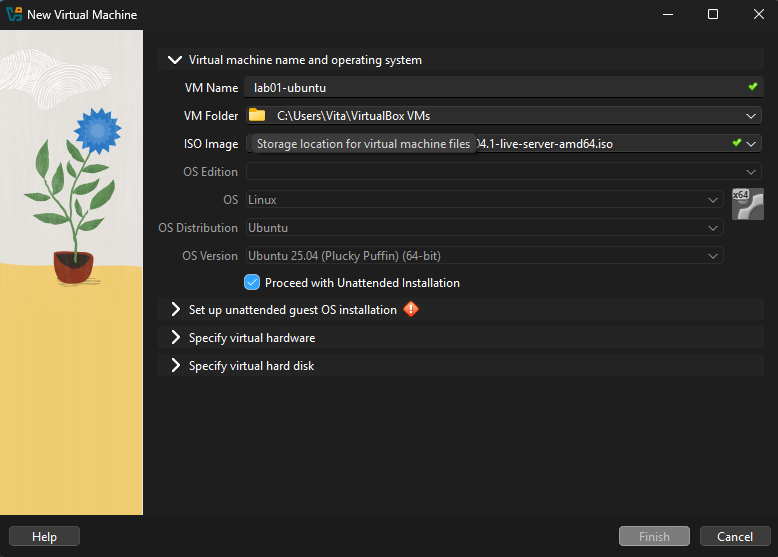
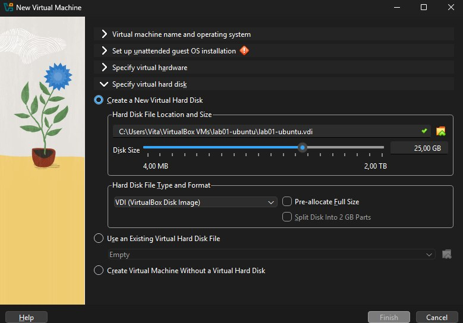
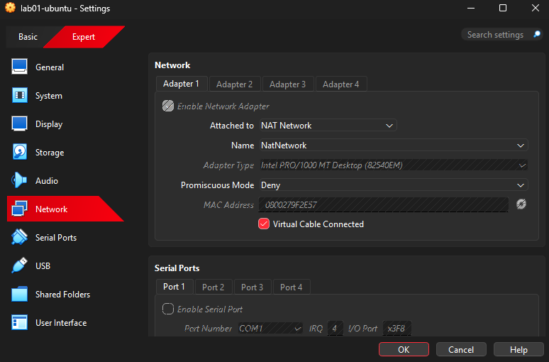
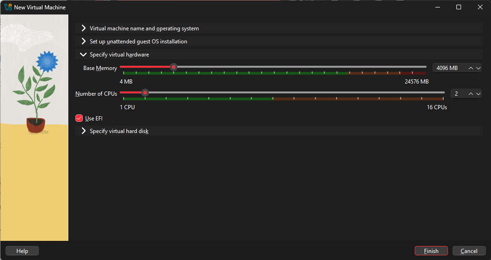
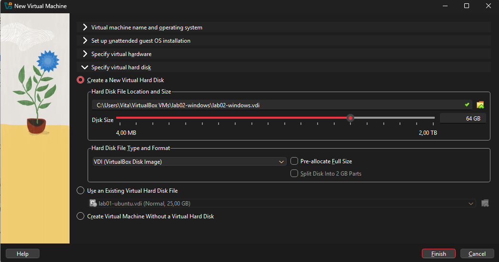
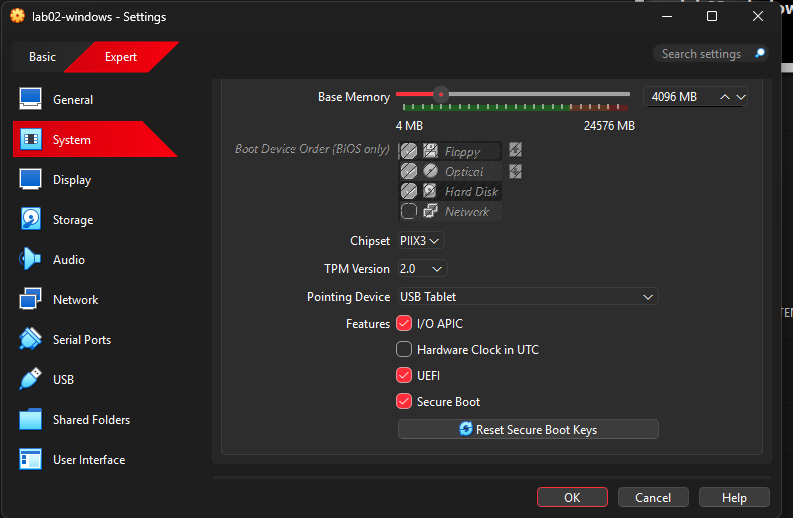
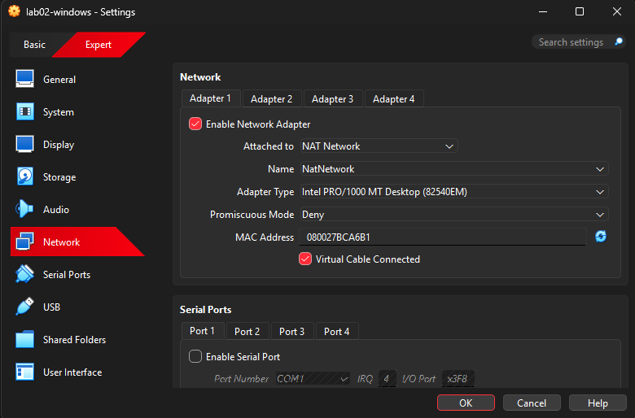
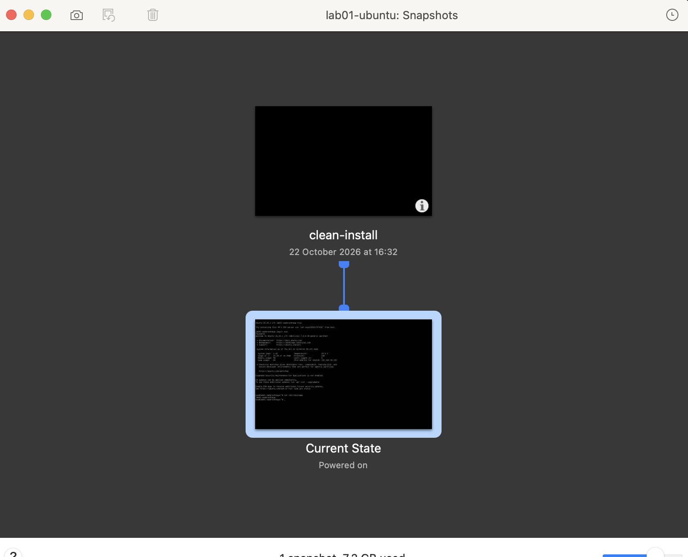

# BUILD.md: a test machine with Ubuntu Server and Windows 11

This document is for someone who has never opened a hypervisor. You need a laptop and an internet connection. Do the steps in order, one action at a time. Each step has a reason ("Why") and a way to check that it worked ("Check").

The screenshots come from my teammate's laptop: Windows 11 Pro, AMD Ryzen 7 7435HS, 24 GB RAM, 512 GB SSD, VirtualBox 7.

## Before you start

1. **Check the processor.** The laptop must have an Intel or AMD processor. A Mac with an Apple Silicon chip (M1–M4) cannot run the Windows evaluation image, because it exists only for Intel/AMD. To check a Mac: Apple menu → About This Mac.
2. **Check virtualisation.** On Windows open Task Manager → Performance → CPU. The line "Virtualization" must say Enabled. If it says Disabled, restart the laptop, enter the UEFI setup (usually F2, F10, Del or Esc), find Intel VT-x, SVM Mode or AMD-V, set it to Enabled, save and restart.
3. **Check memory and disk.** You need at least 16 GB of RAM and about 100 GB of free disk space. Task Manager → Performance → Memory and Disk show both.
4. **Work out the resources.** Do not accept the defaults. The rule: a guest gets at most half of the laptop's cores, and the laptop keeps enough memory for itself.
   Example from this build (24 GB RAM): Ubuntu 4 GB, Windows 4 GB, 2 CPUs each, so 16 GB of RAM stay for the laptop.

Why this comes first: if the processor or the memory is not suitable, the build fails halfway, and a lot of time is lost.

## Part A. Preparation

### 1. Install VirtualBox
Download VirtualBox from https://www.virtualbox.org/wiki/Downloads and run the installer with the default options. Do not install the Extension Pack: it is not needed and has its own licence.

Licence: https://www.virtualbox.org/wiki/Licensing_FAQ. The main program is free, so nobody pays by mistake. VMware Workstation Pro does the same job here, but it needs a Broadcom account.

> Check: VirtualBox opens with an empty list of machines.

### 2. Download the Ubuntu Server ISO
Download the current LTS release for amd64 from https://ubuntu.com/download/server and keep it in the Downloads folder, never inside a Git repository.

Why Server and not Desktop: a test machine does not need a graphical desktop, so it uses less memory and disk. Why LTS: it gets updates for years.

> Check: the file name ends with `.iso` and has `server` in it.

### 3. Download the Windows 11 Enterprise evaluation ISO
Open https://www.microsoft.com/en-us/evalcenter/download-windows-11-enterprise, fill in the short form and download the 64-bit ISO in English (United States).

Why the evaluation: it is free and legal for 90 days and needs no product key. Never type your own key into a test machine and never download a "pre-activated" Windows, because that is pirated software. Trade-off: after 90 days the evaluation expires, so this machine is for testing only.

> Check: the file is several gigabytes and ends with `.iso`.

### 4. Create one shared network
In VirtualBox open File → Tools → Network Manager → NAT Networks → Create. Keep the name `NatNetwork`.

Why a NAT Network and not another mode: both guests need the internet and must see each other.
- Plain NAT: the internet works, but each VM has its own private router, so the guests cannot see each other.
- Host-only: the guests see each other, but there is no internet.
- Bridged: both work at home, but office and campus networks often refuse devices they do not know.

Trade-off: the laptop cannot reach the guests directly. To connect from the laptop (for example by SSH) you must add a port-forwarding rule.

> Check: the network is in the list and enabled. Do this before creating the VMs, so that no VM has to be reconfigured later.

## Part B. The Ubuntu Server guest

### 5. Create the VM
Machine → New. Name `lab01-ubuntu`, choose the Ubuntu ISO, Type Linux, Version Ubuntu (64-bit). Tick **Skip Unattended Installation**. Set Base Memory 4096 MB and 2 CPUs; leave "Use EFI" unticked. Create a 25 GB virtual disk and leave "Pre-allocate Full Size" unticked.




Why these values: a server without a desktop needs little, and the laptop needs the rest. Why a dynamic disk: it takes space on the laptop only as it fills, so 25 GB are not lost at once. Why skip the unattended installation: you see the real installer. Why no EFI: Ubuntu Server does not need it; only Windows 11 does.

> Check: the VM appears in the list as "Powered Off".

### 6. Attach the VM to the shared network
Settings → Network → Adapter 1 → Attached to: NAT Network, Name `NatNetwork`.



> Check: the Name field shows `NatNetwork`.

### 7. Install Ubuntu Server
Start the VM and click inside its window. Choose, in order:
1. Boot menu: Try or Install Ubuntu Server.
2. Language English, keyboard English (US).
3. Type of install: Ubuntu Server (not minimized).
4. Network: leave the automatic (DHCP) address. Proxy: empty. Mirror: the default.
5. Storage: Use an entire disk. This is the 25 GB virtual disk, so the real disk is safe.
6. Profile: your name, a server name (mine: `lab01-ubuntu`), a short lowercase username and a password. Write the password on paper, not in a file.
7. Ubuntu Pro: skip. SSH: tick Install OpenSSH server. Featured snaps: select nothing.
8. When "Installation complete!" appears choose Reboot Now. If it asks to remove the installation medium, press Enter.

Why Server and not Desktop: a graphical login screen means the Desktop ISO was used, and the installation must start again. Why OpenSSH: it lets you copy text out of the VM.

> Check: after the restart you log in on a text console.

### 8. Check the guest
Run these commands inside the VM:

```bash
uname -a
lsb_release -a
ip addr
```

Look at the network card (`enp0s3`), not `lo`. The line `inet 10.0.2.x` is the address of the VM.

> Check: the output shows Ubuntu Server and an address starting with `10.0.2.` (mine: 10.0.2.15). Full output: `evidence/04-guest-uname.txt`.

## Part C. The Windows 11 guest

### 9. Create the VM
Machine → New. Name `lab02-windows`, choose the Windows ISO, Type Microsoft Windows, Version Windows 11 (64-bit). Tick **Skip Unattended Installation**. Set 4096 MB and 2 CPUs, tick **Use EFI**. Create a 64 GB disk and leave "Pre-allocate Full Size" unticked.




Why these values: 4 GB, 2 CPUs and 64 GB are the minimum for Windows 11. A dynamic disk again keeps the 64 GB from being taken at once.

> Check: the VM appears in the list.

### 10. Check the security settings
Settings → System. **Enable EFI** and **Enable Secure Boot** must be ticked and **TPM Version** must be v2.0. If something is off, turn it on.



Why: Windows 11 will not install without UEFI, Secure Boot and a TPM. Choosing "Windows 11" in the wizard normally turns them on.

> Check: all three are on.

### 11. Attach the VM to the shared network
Settings → Network → Adapter 1 → Attached to: NAT Network, the same name `NatNetwork`.



Why the same name: only machines on the same network see each other.

> Check: the Name field shows `NatNetwork`.

### 12. Install Windows
1. Start the VM. At "Press any key to boot from CD or DVD" click inside the window and press a key once. If you miss it, restart the VM.
2. Language and keyboard: your choice, then Install now.
3. Product key: "I don't have a product key". Edition: **Windows 11 Enterprise (Evaluation)**.
4. Accept the licence, choose Custom: Install Windows only, select Drive 0 Unallocated Space, Next.
5. The VM restarts several times. At the next "boot from CD" prompts press nothing.
6. Country and keyboard: your choice; skip the second keyboard.
7. Sign-in screen: Sign-in options → Domain join instead, then create a local account (name, password, three security questions). If this option is missing, sign in with a free Microsoft account made for this purpose. Write the password on paper.
8. Privacy settings: switch everything off, then Accept.

Why a local account: a test machine does not need a personal Microsoft account.

> Check: the Windows desktop appears. The file [evidence/04b-system-info-windows.txt](evidence/04b-system-info-windows.txt) shows Windows 11 Enterprise Evaluation.

### 13. Install the Guest Additions
In the VM window open Devices → Insert Guest Additions CD image. In Windows open File Explorer → the CD drive and run `VBoxWindowsAdditions.exe`. Accept the defaults and restart (Restart anyway if it asks).

Why: after the restart the screen fits the window and copy-paste between the laptop and the VM works. If copy-paste does not work, check Devices → Shared Clipboard → Bidirectional, and check that the VirtualBox host key is one your keyboard has (File → Preferences → Input; I set it to Right Shift).

> Check: the screen follows when you resize the window.

## Part D. Check the network

### 14. Find the Windows address
In PowerShell run:

```powershell
ipconfig
```

> Check: IPv4 Address starts with `10.0.2.` (mine: 10.0.2.3).

### 15. Ping from Windows to Ubuntu
In PowerShell run `ping 10.0.2.15` (use the Ubuntu address from step 8).

> Check: four replies, 0% loss.

### 16. Ping from Ubuntu to Windows
In Ubuntu run `ping -c 4 10.0.2.3` (the Windows address from step 14).

This **times out**, although the network is fine: Windows Defender Firewall blocks incoming ping by default. Open PowerShell **as Administrator** and run:

```powershell
New-NetFirewallRule -DisplayName "Allow ping in (ICMPv4)" -Protocol ICMPv4 -IcmpType 8 -Direction Inbound -Action Allow
```

Why a rule and not switching the firewall off: the rule opens only ping; switching the firewall off would leave the whole machine open.

> Check: run the ping from Ubuntu again; four replies come back.

### 17. Check the internet from both guests
In Ubuntu run `ping -c 4 ubuntu.com`, in Windows run `ping ubuntu.com`.

> Check: replies from both. All four pings, unedited: [evidence/05-ping-between-guests.txt](evidence/05-ping-between-guests.txt).

## Part E. Clean snapshot and rollback

### 18. Take a clean snapshot of each VM
Do this now, before anyone experiments. Shut the VM down (in Ubuntu `sudo poweroff`, in Windows Start → Power → Shut down). In VirtualBox select the VM, click the menu icon next to its name → Snapshots → Take, name it `clean-install`. Start the VM again.



Why: this makes "try things without breaking anything" true. A snapshot taken after the damage has nothing clean to go back to. A switched-off VM gives a smaller and faster snapshot.

> Check: `clean-install` appears in the snapshot list.

### 19. Go back to the clean state
When the VM is broken: power it off, open Snapshots, select `clean-install` and click Restore. Untick "Create a snapshot of the current machine state" (otherwise you keep the broken state), confirm and start the VM.

> Check: the VM is as it was at step 18, and everything done after that is gone.

## When something goes wrong

| Symptom | Reason | Fix |
|---|---|---|
| Windows says "This PC can't run Windows 11" | EFI, Secure Boot or TPM is off, or memory is below 4 GB | Step 10, and give 4096 MB |
| The installation starts again after a restart | A key was pressed at "boot from CD" | Press nothing at that prompt; restart the VM |
| Copy-paste between the laptop and the VM does not work | No Guest Additions, the clipboard is off, or the host key is one the keyboard does not have | Step 13: Bidirectional clipboard and a host key your keyboard has |
| Ping from Ubuntu to Windows times out | Windows Defender Firewall blocks incoming ping | Step 16 |
| A guest has no address, or the guests do not see each other | A VM is not on `NatNetwork`, or its adapter is off | Steps 4, 6 and 11, then restart the VM |
| The laptop becomes very slow | The guests got more memory than the laptop has | Shut both down and set 4 GB each |
| A graphical login screen appears on Ubuntu | The Desktop ISO was used | Start again with the Server ISO |
